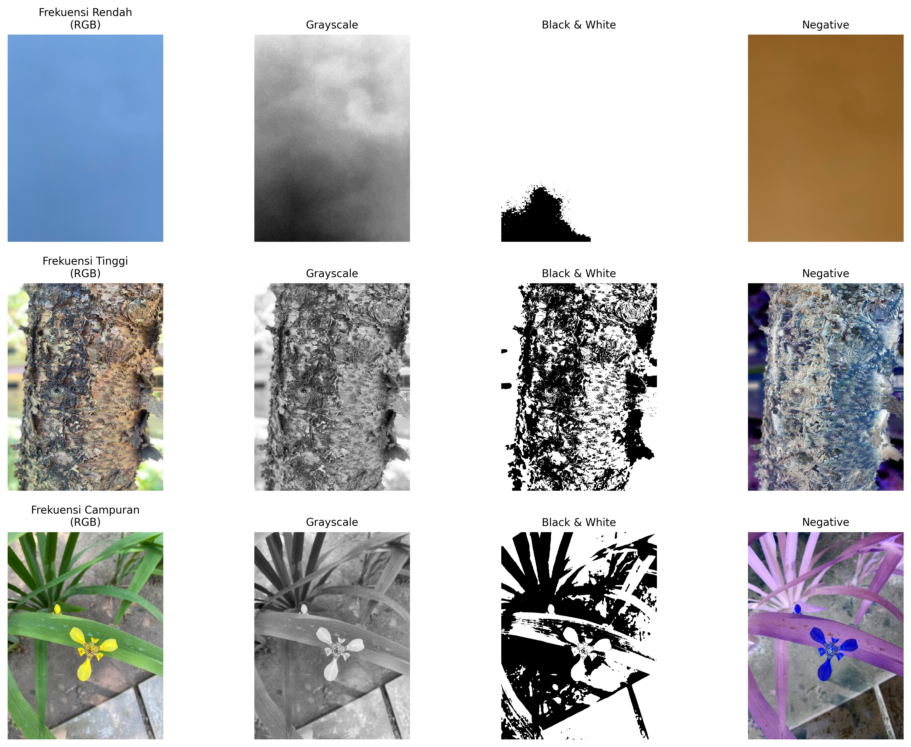

# Pemrosesan Citra Digital: Konversi Citra & Operasi Dasar

Repository ini berisi implementasi pemrosesan citra digital menggunakan bahasa pemrograman Python, library OpenCV, dan Matplotlib. 

📌 Deskripsi Tugas
Tugas ini bertujuan untuk melakukan manipulasi dan konversi citra pada tiga jenis dataset frekuensi (Frekuensi Rendah, Frekuensi Tinggi, dan Frekuensi Campuran) menjadi 3 bentuk operasi dasar:
1. **RGB to Grayscale**
2. **RGB to Black and White (Binary / Thresholding)**
3. **RGB to Negative**

🖼️ Hasil Visualisasi Matriks
Berikut adalah hasil pemrosesan citra dari seluruh dataset:

🛠️ Modul & Library yang Digunakan
* `OpenCV (cv2)` - Pemrosesan dan manipulasi citra
* `Matplotlib` - Visualisasi dan pembuatan grid matriks
* `NumPy` - Operasi array pada nilai piksel
